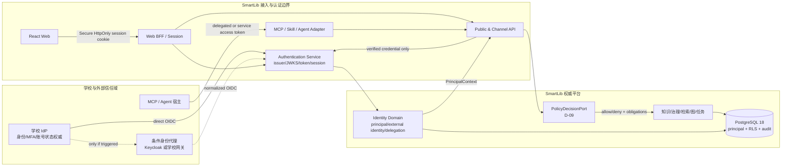
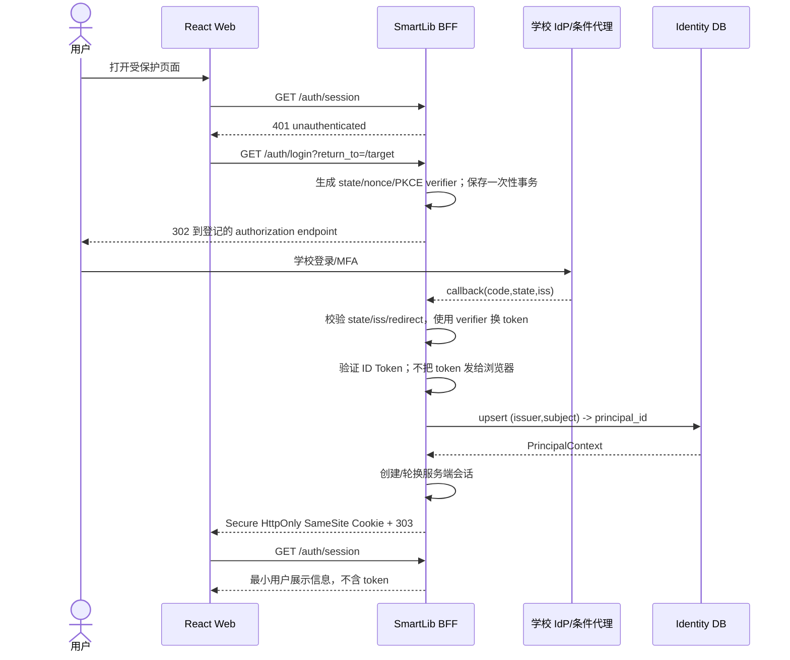
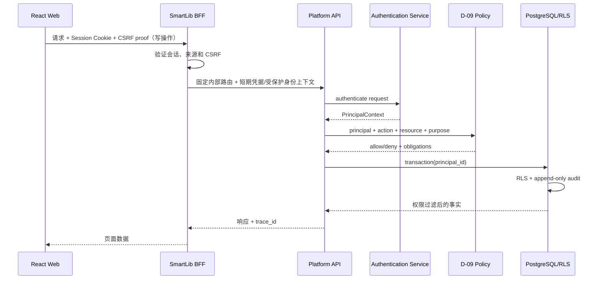
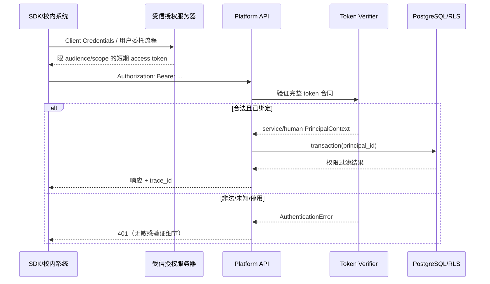
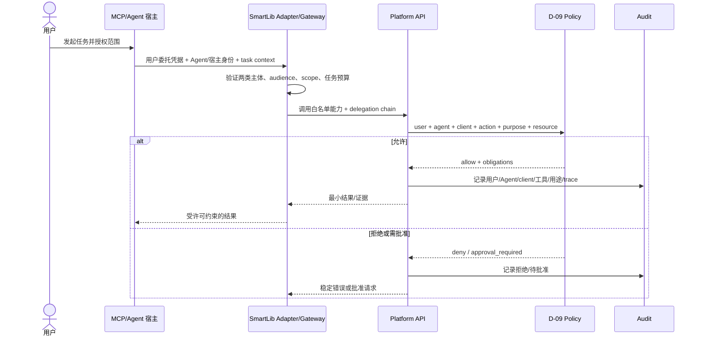

# D-08 统一身份认证逻辑架构与信任边界 v1.0

- 状态：目标逻辑架构已形成；Demo 阶段延后实施
- 日期：2026-08-26
- 目的：供恢复 D-08 时固定跨入口认证职责、信任边界和数据流；当前 Demo 不实现，不替代 D-09 授权架构

## 1. 逻辑架构

图中虚线表示条件部署分支，不是首版固定组件。学校 IdP 与条件代理都不能被领域模块直接调用；所有入口最终只向核心提供同一种 `PrincipalContext`。

## 2. 五个信任边界

### TB-1：浏览器边界

浏览器和其中运行的 JavaScript 均视为不可信。浏览器可以保存不透明的会话 Cookie，但不能获得 refresh token，默认也不能获得 access token。Cookie 不能证明授权，只用于让 BFF 查找服务端会话。

### TB-2：外部发行者边界

只有部署配置中登记的精确 issuer 才受信。Discovery 和 JWKS 是该发行者的元数据来源，不得根据请求中的 issuer 动态添加信任。TLS 成功不等于 token 合法；仍须验证签名、算法、audience、时间、client 和 token 类型。

### TB-3：渠道适配器边界

Web BFF、Public API、MCP/Skill/Agent Adapter、小程序 BFF 和客户端是不同客户端，必须有独立 client/audience/scope。适配器不能把自己的高权限服务身份替换用户身份；发生委托时必须同时保留用户、代理主体、任务和授权范围。

### TB-4：认证—授权边界

Authentication Service 只回答“这个凭据代表哪个主体、以何种方式认证、代表哪个 client”。D-09 PolicyDecisionPort 才回答“该主体在此用途和上下文下能否对该资源执行动作”。学校角色、院系或 MFA 结果只是策略输入。

### TB-5：应用—数据库边界

数据库只接受由认证服务产生的内部 `principal_id` 写入事务变量 `smartlib.actor_id`。RLS 不解析 JWT，也不信任外部 `sub`、email、姓名或请求头。身份映射、策略决定和业务写操作均进入 append-only 审计。

## 3. Web 登录与 BFF 时序

`return_to` 只能是登记的站内相对路径，防止开放跳转。Callback 失败不返回学校响应原文、token 或 claims；只返回安全错误码和 trace ID。

## 4. Web 调用业务 API 时序

BFF 如果和 Platform API 同进程，也必须保留逻辑边界和测试边界；不能因为物理合并而跳过认证、授权或 RLS。

## 5. Public API 与服务主体时序

服务主体必须映射到独立 `principal_id`，不得借用管理员或开发人员 UUID。Client Credentials 不代表任何自然人。

## 6. MCP / Agent 委托时序

委托不是简单传递用户 token。Gateway 必须让平台同时识别用户、Agent/宿主、调用工具、任务用途与批准状态，避免审计只看到最终用户或只看到网关服务账号。

## 7. 威胁—控制—验收证据映射

| 威胁 | 核心控制 | 必须出现的验收证据 |
|---|---|---|
| 伪造 actor header | 非开发不注册 development authenticator；OpenAPI 无该 header | production 配置负向测试、OpenAPI 契约快照 |
| 错 issuer / 混淆攻击 | issuer allowlist、callback `iss`、精确 redirect | 双 issuer 相同 sub、错误 iss、错误 redirect 测试 |
| 授权码注入/重放 | PKCE S256、state、nonce、一次性事务 | code 重放、state/nonce 错误、PKCE downgrade 测试 |
| token 被前端脚本窃取 | BFF、服务端 token、HttpOnly Cookie、CSP | storage/源码/网络 URL 扫描与浏览器 E2E |
| BFF 任意代理泄漏 token | 固定 route map、目标/方法白名单 | 任意 URL、路径穿越、未允许 method 负向测试 |
| JWT 算法/密钥攻击 | 算法白名单、受信 JWKS、kid 轮换、拒绝 `none` | 错签名、`alg=none`、未知 kid、轮换测试 |
| 跨 API token 复用 | audience、scope、token type、client 检查 | 错 audience、ID Token 充当 access token 测试 |
| 账号错误合并/接管 | `(issuer,subject)` 唯一；冲突冻结；禁止 email 主键 | 同名、邮箱变化、双 issuer、绑定冲突测试 |
| Agent 冒充用户 | human/agent/client 分型和 delegation chain | 审计同时显示 user、agent、client、task |
| 学校 role 绕过许可 | AuthN/AuthZ 分离；D-09 + 许可默认拒绝 | 高角色但无许可仍拒绝的集成测试 |
| IdP/JWKS 故障导致放行 | 未知凭据失败关闭；缓存和过期策略有界 | JWKS 中断、新旧密钥和缓存过期测试 |
| token/claims 泄漏日志 | 结构化安全摘要、敏感字段过滤 | 日志/错误/审计扫描结果为 0 |

## 8. 物理部署边界

首期可将 BFF、Authentication Service 和 Platform API 部署在同一 FastAPI 制品中，降低 Demo/试点运维复杂度，但代码模块、端口和测试必须分离。随着公开 API、MCP/Agent 或多渠道流量增长，可将 BFF/Adapter 独立部署，核心身份合同和 `principal_id` 不变化。

条件 Keycloak/学校网关始终部署在 SmartLib 核心之外。PostgreSQL 保存 SmartLib 主体映射和审计，不保存学校密码；学校目录和账号生命周期仍归学校身份平台。

## 9. 与后续决策的接口

- D-09 接收 `PrincipalContext`，定义角色、关系、属性、用途、许可和 RLS 的组合授权；
- D-13 决定哪些入口进入首版，但所有入口必须复用本文件身份合同；
- D-14 决定 MCP/Agent 外部开放、白名单和逐次批准等级；
- D-11 决定 Compose/Kubernetes 部署演进，但不得改变信任边界；
- 学校身份事实缺失时，本地测试 issuer 只能证明协议骨架，不能证明生产统一身份已接通。
