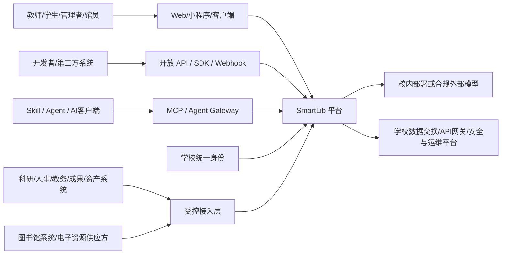
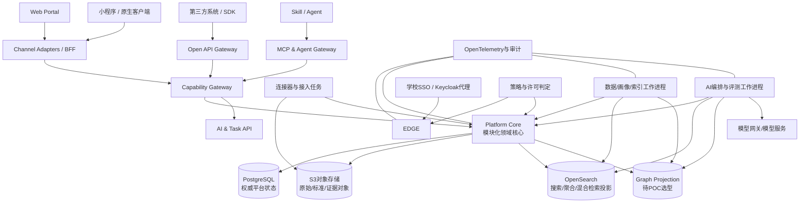

# SmartLib 智能知识平台技术架构与技术选型决策方案 v1.0

**文件状态：** 技术决策草案，供项目负责人评审与拍板  
**形成日期：** 2026-08-25  
**适用范围：** SmartLib 最终系统及其可持续演进的首版平台  
**上位依据：** `work/smartlib_overall_design.md`  

## 0. 技术摘要

SmartLib 当前版本必须定位为**最终系统的首个可运行版本**，而不是一次性展示站点。首版可以只展示学者星图等部分能力，但已纳入范围的页面必须调用真实的公共 API、真实数据库和适用的真实权限判断；只有纳入真实异步任务范围的页面才要求接通真实任务状态。尚未接通的外部数据通过同一契约的样例连接器或种子数据进入，而不是把业务数据硬编码在页面中。

本方案建议采用“**模块化平台核心 + 独立数据/AI 工作进程 + 多模型数据投影 + 统一治理横切层**”的演进架构：

- 平台核心首期采用模块化单体，按领域划清边界，不在需求和团队尚未稳定时拆成大量微服务；
- 数据接入、实体消歧、索引构建、图谱构建、模型调用等计算任务通过独立工作进程异步执行；
- PostgreSQL 保存平台权威状态，原始与大对象进入 S3 兼容对象存储；OpenSearch、图数据库和向量索引都是可重建投影，不成为唯一事实来源；
- 页面、应用和智能体只调用公共服务，不直接访问底层数据库，也不各自维护画像、权限、许可或知识关系；
- 统一身份、细粒度授权、电子资源许可、来源证据、数据质量、审计和可观测性从首版即进入真实链路；
- 首版用容器化方式在单机或少量服务器运行，保持同一镜像和配置模型，基础设施成熟后再迁移到 Kubernetes。

**已确认基线：** React 19.2/TypeScript 6/Vite 8 校内 Web（ADR-0004）；Python 3.14/FastAPI 平台核心（ADR-0003）；PostgreSQL 18 权威主库（ADR-0002）；Docker Compose 起步、Kubernetes 演进（ADR-0001）。平台从首版起采用多入口架构，通过统一能力与接入网关同时服务 Web、开放 API、Skill、MCP、Agent、小程序、客户端和后续第三方应用。Python 核心采用强制模块边界测试、类型检查、契约测试和事务集成测试；图数据库、搜索、数据集成引擎、工作流引擎和元数据治理产品应通过真实数据 POC 后再定。

## 1. 纠偏后的工程目标

### 1.1 首版不再是什么

首版不再是：

- 与最终架构无关的静态演示页；
- 页面里堆放 mock 数组、点击后切换假状态的“伪系统”；
- 为领导演示单独维护、正式建设时全部推倒重来的代码；
- 把学者星图等单一应用误当作 SmartLib 总平台；
- 先选一个大模型，再围绕模型拼接数据和页面。

### 1.2 首版必须已经具备的“真”能力

即使首版数据量很小，也必须真实具备：

1. **真实持久化：** 对象、资源、关系、来源、许可、任务、审核和审计进入数据库。
2. **真实接口：** 展示页面通过版本化 API 获取数据；OpenAPI 契约可测试、可生成客户端。
3. **真实身份和权限路径：** 开发环境可使用测试身份，但接口执行真实授权判断。
4. **真实异步任务：** 数据导入、画像重建、索引构建和 AI 任务有任务编号、状态、进度、失败原因和重试记录。
5. **真实来源与证据：** 事实、分析、推断、人工确认分层；结果能追到来源、版本和时间。
6. **真实可替换边界：** 搜索、图谱、向量、模型和外部连接器通过端口/适配器接入。
7. **真实运维基础：** 配置分环境、结构化日志、指标、追踪、健康检查、备份和恢复脚本进入仓库。
8. **真实多入口：** Web、API、MCP、Agent、小程序和客户端至少共享同一组能力契约、授权策略和审计语义；尚未上线的入口也不能通过页面私有接口形成技术封锁。

### 1.3 可以暂时“少”，但不能“假”的部分

- 外部系统可以只先接 1–2 个，但连接器协议和接入登记是真实的；
- 学者可以只有真实授权样本和脱敏样本，但画像数据模型、来源和权限是真实的；
- 图谱可以只包含少量关系类型，但关系证据和重建机制是真实的；
- AI 可以只开放一个可信问答场景，但检索、许可过滤、引用、任务记录和人工确认是真实的；
- 高可用可以暂不启用，但备份、恢复和未来拓扑必须有明确路径。

## 2. 架构原则：现在即冻结

以下原则建议作为项目级架构约束，不随具体产品选型改变。

### 2.1 权威来源与派生投影分离

- 学校业务系统继续拥有业务事实；SmartLib 不直接修改源系统生产数据。
- PostgreSQL 保存 SmartLib 自己的权威状态：接入登记、统一标识、治理结果、画像版本、许可规则、审核状态、任务和审计索引。
- 搜索索引、向量索引和图数据库是可从权威数据与对象存储重建的投影。
- 每个投影记录 `source_version`、`policy_version`、`model_version` 和构建任务编号。

### 2.2 契约先于实现

- 外部连接器、内部模块、前后端、模型供应方都通过版本化契约交互。
- REST API 采用 OpenAPI；事件采用版本化 JSON Schema 或 Avro；批量交换采用带清单和校验和的文件包。
- 底层产品替换不得改变上层业务语义；必要时由适配器吸收差异。

### 2.3 权限、许可与证据进入每条链路

授权不是登录时的一次判断，而至少发生在：数据进入、治理处理、索引构建、检索召回、模型上下文组装、结果输出、导出和管理操作。

### 2.4 模块化单体起步，按证据拆分

首版采用 Python/FastAPI 模块化单体降低分布式事务、接口协调和运维负担。模块边界由包结构、公开应用服务、架构测试、类型检查和代码审查共同强制；可靠外发事件继续使用 PostgreSQL Outbox，不依赖 Web 框架内部事件。该治理要求已在 ADR-0003 冻结。

只有满足以下条件之一才拆成独立服务：

- 有独立扩缩容或硬件需求；
- 有独立安全区或数据出域边界；
- 有独立发布节奏和稳定团队所有权；
- 已形成明显性能热点或故障隔离需求；
- 第三方产品天然以独立服务部署。

### 2.5 不让 AI 框架成为平台架构

模型、提示词、智能体框架和向量库都是可替换组件。SmartLib 自己掌握任务定义、工具契约、知识证据、权限许可、模型路由、评价集和运行记录。

### 2.6 多入口、单能力源

Web、小程序、客户端、开放 API、Skill、MCP 和 Agent 是不同的消费与交互方式，不是七套业务系统。所有入口都必须调用同一组领域应用服务，并共享：

- 统一对象、画像、资源、关系和任务标识；
- 统一身份、委托身份、服务身份与权限上下文；
- 统一电子资源许可动作词表；
- 统一来源、证据、质量和版本语义；
- 统一限流、配额、成本、审计和撤销机制；
- 统一错误码、幂等、异步任务和长流程状态。

禁止为某个 Agent、Skill、小程序或客户端复制数据库、画像规则、RAG 索引或许可判断。渠道差异由渠道适配器吸收，不进入领域核心。

## 3. 目标系统全景架构

### 3.1 系统上下文



### 3.2 容器级架构



### 3.3 领域模块

平台核心至少包含以下领域模块。它们首先是代码与数据所有权边界，不代表首期必须分别部署。

| 领域模块 | 核心职责 | 不应承担的职责 |
|---|---|---|
| Identity & Organization | 用户映射、组织快照、角色和身份上下文 | 保存学校账号密码 |
| Resource & License | 电子资源目录、许可条款、使用动作、到期与范围 | 替代供应方资源平台 |
| Source & Ingestion | 数据源登记、连接器配置、接入批次、原始清单 | 把治理逻辑写死在连接器 |
| Entity & Master Data | 统一标识、实体解析、合并拆分、别名 | 自动把低置信度匹配当事实 |
| Profile | 事实画像、分析画像、画像版本与解释 | 存放应用专属页面状态 |
| Knowledge | 实体、关系、证据、时间和置信度 | 把推断关系伪装为业务事实 |
| Search & Discovery | 查询解析、召回、聚合、排序、权限过滤 | 成为权威数据源 |
| Intelligence | 模型路由、RAG、工具、智能体、评价 | 绕过授权直接访问数据 |
| Knowledge Services | 学者星图等场景编排与反馈 | 复制公共画像和规则 |
| Governance & Audit | 质量、血缘、审核、策略版本、审计检索 | 替代业务责任部门判断 |
| Operations | 配置、任务、通知、健康、成本与容量 | 混入领域事实模型 |

### 3.4 应用边界

四个产品模块继续是稳定的管理和产品主干：SmartLib DataHub、SmartLib Knowledge Network、SmartLib Intelligence、SmartLib Knowledge Services。它们共同调用上述领域能力；学者星图、知源智研、学科罗盘、成果智桥是服务应用，不拥有独立数据底座。

### 3.5 多入口交付架构

| 入口/消费者 | 主要使用者 | 交互特点 | 技术出口 | 身份模式 |
|---|---|---|---|---|
| Web | 校内用户、管理者、馆员 | 完整可视化与管理操作 | Web BFF + REST/SSE | OIDC/SAML 登录会话 |
| 小程序 | 移动用户、轻量服务 | 短流程、消息提醒、扫码/分享 | 小程序 BFF | 学校身份绑定 + 平台短期令牌 |
| 原生/桌面客户端 | 专业用户、馆员、研究人员 | 本地文件、批处理、长任务 | Public API + SDK | OIDC PKCE / 设备授权 |
| 开放 API | 校内系统、合作方、开发者 | 稳定机器接口、批量与异步 | REST/OpenAPI、Webhook、事件订阅 | OAuth2 客户端、mTLS、受控 API Key |
| Skill | 人与 AI 使用的任务模板 | 指令、参数、资源和步骤封装 | 调用 Public API 或 MCP | 继承调用者/运行环境授权 |
| MCP | AI 客户端、Agent、开发工具 | 发现工具、资源和提示模板 | Streamable HTTP MCP Server | OAuth/委托令牌、工具级批准 |
| Agent | 科研、学科、资源与治理智能体 | 多步计划、工具调用、暂停和人工确认 | Agent Gateway + MCP/API | 用户委托身份或独立服务主体 |
| 第三方应用 | 校内外受控生态 | 嵌入、联合服务、数据交换 | API/SDK/MCP（按风险开放） | 注册应用、合同与用途授权 |

### 3.6 能力目录和协议适配

平台应先定义与协议无关的“能力目录”，例如：

- `search_resources`：检索资源；
- `get_object_profile`：读取对象画像；
- `query_relationships`：查询知识关系；
- `start_analysis_task`：启动分析任务；
- `get_task_status`：查看任务状态；
- `submit_correction`：提交纠错；
- `request_export`：申请导出；
- `approve_candidate_relation`：审核候选关系。

每项能力定义输入、输出、风险等级、所需许可动作、幂等要求、同步/异步模式、数据版本和审计字段。随后再分别映射为 REST endpoint、SDK 方法、MCP tool/resource、Skill 步骤和 Agent tool。这样更换协议或 AI 框架不会迫使领域能力重写。

MCP 的作用是把工具和上下文标准化暴露给模型应用；OpenAI Agents SDK 支持 Hosted MCP、Streamable HTTP 和 stdio 等连接方式，并提供工具过滤、批准和追踪机制。SmartLib 的生产 MCP 应优先采用受认证的 Streamable HTTP，stdio 仅用于本地开发；敏感写操作默认要求明确批准（[OpenAI Agents SDK MCP](https://openai.github.io/openai-agents-python/mcp/)）。

## 4. 数据架构

### 4.1 数据分区

| 区域 | 内容 | 保存策略 |
|---|---|---|
| Source Registry | 数据源、责任人、接口、授权、更新周期 | PostgreSQL，版本化 |
| Raw Zone | 原始文件、API 响应包、校验清单、抓取批次 | S3 对象存储，只追加或保留历史 |
| Standard Zone | 清洗后的表格/Parquet/JSON、标准编码 | S3 + PostgreSQL 元数据 |
| Master & Profile | 统一对象、映射、画像快照、规则结果 | PostgreSQL，双时间或版本历史 |
| Knowledge Canonical | 关系事实、候选关系、证据引用、状态 | PostgreSQL 规范表 |
| Serving Projections | 搜索、图、向量、聚合视图 | OpenSearch/图数据库/缓存，可重建 |
| Operation & Audit | 任务、事件、访问、导出、模型调用 | PostgreSQL + 日志存储，分级留存 |

### 4.2 PostgreSQL 的角色

建议将 PostgreSQL 作为首版平台事务与治理状态的主数据库。其 JSONB 适合保存可演进但仍需索引的来源扩展字段；行级安全策略可以按用户或角色限制可见记录，并在无匹配策略时默认拒绝，可作为应用授权之外的纵深防护（[JSON 类型](https://www.postgresql.org/docs/current/datatype-json.html)，[Row-Level Security](https://www.postgresql.org/docs/current/ddl-rowsecurity.html)）。

但 RLS 不代替平台策略服务：电子资源许可还取决于使用动作、目的、资源、用户群、网络环境、到期时间以及是否允许 TDM、向量化、模型输入和再发布。

### 4.3 对象和关系的最小公共模型

所有对象至少含：

`object_id`、`object_type`、`canonical_name`、`source_refs`、`valid_time`、`system_time`、`visibility`、`license_tags`、`quality_state`、`review_state`、`version`。

所有关系至少含：

`relation_id`、`subject_id`、`predicate`、`object_id/value`、`fact_class`、`evidence_refs`、`confidence`、`valid_time`、`system_time`、`visibility`、`license_tags`、`review_state`、`model_version`。

其中 `fact_class` 至少区分：业务系统事实、文献事实、供应方记录、统计分析、算法推断、人工确认和用户贡献。

### 4.4 事件与一致性

- 平台核心在同一数据库事务中写业务状态和 Outbox 事件；
- 投影工作进程消费事件更新 OpenSearch、图谱和缓存；
- 消费端必须幂等，并记录投影水位；
- 权限或许可变更事件优先级最高，触发索引重建/失效和缓存清理；
- 任何投影都必须支持按对象、数据源或策略版本重建。

首版可使用 PostgreSQL Outbox + RabbitMQ；Kafka 只有在学校已有平台、CDC 规模或事件回放需求明确时再引入。

## 5. 搜索、向量与图谱架构

### 5.1 统一查询服务

应用不直接查询 OpenSearch、图数据库或向量库。统一查询服务负责：

1. 解析用户意图和过滤条件；
2. 形成权限与许可上下文；
3. 分别调用关键词、语义和关系召回；
4. 在进入模型前再次过滤；
5. 归并排序并保留每个结果的证据、版本和召回路径；
6. 输出可解释结果或拒答原因。

### 5.2 搜索引擎选项

| 选项 | 优势 | 主要代价 | 适用判断 |
|---|---|---|---|
| OpenSearch 3.8.x | Apache 2.0、自托管；全文、聚合、向量和混合搜索集中；支持统一前置过滤、基于分数或 RRF 的融合 | 新增 JVM 集群、索引和快照运维；CJK/ICU 与融合方法必须用真实数据评测 | **POC 主路线，达标后才实施** |
| Elasticsearch 9.4.x | 生态成熟、团队熟悉度可能更高 | 官方发行版许可、订阅功能和采购边界需逐项核验 | 学校已有成熟 Elastic 平台和权益时加入 POC |
| PostgreSQL 18 FTS + pgvector 0.8.6 | 组件少、事务与 RLS 路径一致；支持精确、HNSW、IVFFlat 和迭代扫描 | 中文专业分词、高选择性过滤后的 ANN 召回、复杂聚合和权威库资源竞争需实测 | **同场基线；收益不足时作为首版路线** |
| Qdrant | 专用向量检索、过滤和混合查询；支持分布式自托管 | 新增独立系统；自托管扩容和负载均衡需运维 | 向量规模/延迟经压测证明 OpenSearch 不足时 |

OpenSearch `hybrid` 查询可对全部子查询应用同一前置过滤器，符合 SmartLib 的“召回前限制可见范围”方向（[Hybrid query](https://docs.opensearch.org/latest/query-dsl/compound/hybrid/)）。RRF 适合在词法和向量分数不可直接比较时起步，但官方六个 BEIR 数据集基准中其平均 NDCG@10 比基于分数的混合管道低 3.86%，所以融合方法必须用自己的判断集选择（[OpenSearch RRF](https://docs.opensearch.org/latest/vector-search/ai-search/hybrid-search/rrf/)）。pgvector 支持精确检索、HNSW、IVFFlat 和迭代扫描，但官方也提示 ANN 过滤可能导致返回结果少于预期，多租户共享近似索引会相互影响召回和速度（[pgvector](https://github.com/pgvector/pgvector)）。

**已确认 POC 路线：** 项目负责人确认 OpenSearch 3.8.x 为 POC 主路线，同时以 PostgreSQL 18 FTS + pgvector 0.8.6 为同场基线。只有真实授权样本上的权限零泄漏、中文相关性、混合召回、性能、资源、投影一致性和重建全部达标，才确认 OpenSearch 为首版实施底座；收益不足以覆盖独立集群成本时，首版采用 PostgreSQL 适配器。首期不额外引入专用向量数据库，保留 `VectorIndexPort`，在真实评测证明需要后再通过新 ADR 选择 Qdrant/Milvus。详细见《D-04 搜索与首期向量技术选型调研 v1.0》和 ADR-0005。

### 5.3 图数据库选项

| 选项 | 优势 | 主要代价/风险 | 建议 |
|---|---|---|---|
| Apache HugeGraph 1.7 | Apache 2.0；REST、Gremlin 与 Cypher 接口；支持属性图、索引和可替换存储后端 | 当前 Demo 的单机 RocksDB 不是生产高可用方案；部署、备份和容量边界仍需验证 | **当前专用图投影；通过 GraphPort 对应用提供能力** |
| Apache AGE | Apache 许可；作为 PostgreSQL 扩展支持 SQL + openCypher 混合查询，组件少 | PG18 的仓库声明、网站文档和发布制品成熟度存在漂移；扩展升级、RLS、备份及主库故障域必须验证 | 使用独立 PG18 图投影实例的兼容性副线，不直接安装到权威主库 |
| NebulaGraph | 面向分布式大图、水平扩展 | 组件和运维复杂度高，团队学习成本高 | 只有真实规模/性能证明需要时评估 |
| 仅 PostgreSQL 关系表 | 最少组件、权威数据一致 | 多跳查询、图算法和图开发体验有限 | 首版规范存储与降级路径，不作为长期图能力结论 |

HugeGraph 通过图空间、Schema、顶点、边和 Cypher API 提供当前投影能力。SmartLib 不向 Web、Agent 或其他客户端暴露原生查询接口和图数据库凭据，所有访问都经过 GraphPort、权限前置过滤和 service 后验。Apache AGE 仓库当前声明支持 PostgreSQL 18，但正式制品、升级、RLS、备份和故障域仍需独立验证。

**当前实施路线：** 关系的规范事实继续保存在 PostgreSQL；Apache HugeGraph 1.7 是唯一专用图投影，PostgreSQL 18 递归查询保留为正确性与降级基线。HugeGraph 由 Transactional Outbox 重建，当前 102 个对象、65 条关系已完成回放，同一学者一跳网络与 PostgreSQL 逐 ID 一致。正式服务器部署仍需验证备份恢复、容量、高可用和密钥治理。详细见 ADR-0013。

## 6. 数据接入与治理产品选项

### 6.1 连接器架构

无论采用哪个集成产品，SmartLib 自己定义统一连接器契约：

- `discover()`：发现数据集、字段和能力；
- `snapshot()`：全量或指定范围快照；
- `changes()`：增量/CDC（若源允许）；
- `fetch_object()`：受控获取文件或内容；
- `health()`：连接、授权、配额和到期状态；
- `manifest()`：返回来源、批次、校验和、许可与使用边界。

第三方集成工具只是该契约的适配器，不能成为 SmartLib 的业务模型。

### 6.2 数据移动选项

| 选项 | 适合 | 优点 | 风险 |
|---|---|---|---|
| Apache SeaTunnel 2.3.13 | 数据库、文件、消息、对象存储之间的批量/流式/CDC 同步 | Apache 2.0；统一连接器；新项目可用自带 Zeta 引擎，后续复用 Flink/Spark | 学校特色系统与电子资源仍需自定义连接器；生产恢复需共享状态存储 |
| Airbyte 2.x | SaaS/API 连接器丰富、界面化配置 | 快速接通常见云服务；Builder/CDK 生态较强 | 主仓库/连接器为 ELv2；Core/Enterprise 权益不同；高校本地源和许可语义需逐项验证 |
| Apache NiFi 2.10 | 可视化数据流、路由和边缘接入 | 运维人员可观察数据流、背压和 provenance | 大量流程画布可能难以代码审查；NiFi Registry 已弃用，应采用 Git Registry Client |
| 自研连接器 + 任务框架 | 首批 1–3 个特定系统 | 最小依赖、契约完全可控 | 连接器数量增长后维护成本上升 |

SeaTunnel 官方文档列出批处理、流处理、CDC、Exactly-once 和多表同步能力；对没有既有 Flink/Spark 的新部署，官方建议从 Zeta 引擎起步。端到端仍采用至少一次交付、平台幂等提交和 manifest 对账，不能把引擎 Exactly-once 扩大解释为外部源到 SmartLib 规范对象的全链路保证（[Engine Overview](https://seatunnel.apache.org/docs/engines/overview/)，[2.3.13 Connectors](https://seatunnel.apache.org/docs/2.3.13/connectors/)，[State and Recovery](https://seatunnel.apache.org/docs/engines/zeta/state-storage-and-recovery/)）。

**当前决定：** Demo 阶段暂缓 D-06，不部署 SeaTunnel 或真实外部连接器；使用明确标记、版本化、可替换的模拟数据，通过真实 PostgreSQL、权限、证据、Outbox、投影和公共 API 链路提供展示。进入真实数据接入前重新打开 ADR-0007，并按当时产品版本、首批真实源和学校基础设施确认路线。原建议与验收要求保留在 D-06 调研和 POC 方案中。

### 6.3 元数据与治理平台

| 选项 | 优势 | 边界 |
|---|---|---|
| OpenMetadata | 连接器、目录、血缘、质量测试、告警和治理界面较完整 | 其通用数据资产模型不能直接代替 SmartLib 的资源许可、对象画像和知识证据模型 |
| DataHub（开源产品） | 元数据事件化、搜索和血缘生态成熟 | 名称与 SmartLib DataHub 冲突；部署组件和二次开发复杂度需评估 |
| Apache Atlas | Hadoop 生态与分类/血缘传统强 | 对非大数据平台、现代数据库和业务可用性通常需更多建设 |
| SmartLib 自建治理域 | 完全贴合资源许可、画像和知识治理 | 通用数据目录、血缘和质量能力重复开发 |

OpenMetadata 当前文档显示其连接器覆盖数据库、消息、管道、存储、搜索等类别，并内置表/字段质量测试、告警和问题处理流（[Connectors](https://docs.open-metadata.org/latest/connectors/)，[Data Quality](https://docs.open-metadata.org/latest/how-to-guides/data-quality-observability/quality)）。

**已确认决定（2026-08-26）：** 当前采用 SmartLib 最小治理域主路线，直接建设来源、资产、数据契约、电子资源许可、质量、责任和审计 API，并把治理页迁出前端 fixture。OpenMetadata POC 延后到首批真实数据源和技术元数据进入后，只评估技术目录、血缘和通用质量加速能力，不把它改名为 SmartLib DataHub，也不替代电子资源许可、画像版本和知识证据模型。详细见 D-07 调研、验收方案和 ADR-0008。

## 7. 应用、后端与开发技术选项

### 7.1 前端

| 方案 | 建议 |
|---|---|
| React 19.2 + TypeScript 6.0 + Vite 8 | **推荐校内平台。** 保留现有 React 资产，以 React Router 7 Data Mode、TanStack Query、OpenAPI 生成客户端和严格测试补齐生产能力；TS7 待工具链完整兼容后升级。 |
| Next.js 16 | 当同一发布单元必须承载公开 SEO、SSR/SSG 或服务端 React 时再选；对已有 FastAPI 权威后端的校内工作台会增加 Node 服务端和第二能力层风险。 |
| Vue 3.5 + TypeScript + Vite | 若学校已冻结 Vue 3 技术规范并提供成熟团队和组件库，可按组织能力优先；当前七个 React 工作区需要重写。 |

必须将 `apps/web/src/data.js` 的演示数据迁出运行态页面：前端只保留测试/展示 fixture，生产路由数据来自 API。建议校内平台保持 Nginx 静态部署和 FastAPI 权威边界；公开门户、小程序和客户端共享契约与设计令牌，不强制共享组件。完整证据、加权比较和确认后的任务见《D-02 前端主路线技术选型调研 v1.0》。

### 7.2 平台核心后端

| 路线 | 交付速度 | 治理与长期维护 | AI/数据协同 | 运维复杂度 | 结论 |
|---|---:|---:|---:|---:|---|
| A. Java Spring Modulith + Python 工作进程 | 中 | 高 | 高 | 中 | 调研阶段推荐，未采用 |
| B. Python FastAPI 平台核心 + Python 工作进程 | 高 | 中 | 很高 | 低到中 | **已确认采用（ADR-0003）** |
| C. TypeScript NestJS 平台核心 + Python 工作进程 | 高 | 中高 | 高 | 中 | 全栈 TS 团队可选 |

FastAPI 原生基于 OpenAPI/JSON Schema，提供类型验证、依赖注入和认证组件，适合数据与 AI 服务接口（[FastAPI Features](https://fastapi.tiangolo.com/features/)）。NestJS 提供模块、守卫、队列、事件、OpenAPI 和多种微服务传输适配，适合 TypeScript 全栈团队（[NestJS Documentation](https://docs.nestjs.com/openapi)，[Microservices](https://docs.nestjs.com/microservices/basics)）。

**原调研推荐 A 的原因：** 平台核心包含长期数据治理、授权、许可、审核和事务一致性；Java/Spring 在此类平台治理上更稳健。该评价保留用于理解技术风险，但不再代表当前决定。

**已确认实施约束：** 项目负责人选择 B。Python 核心必须以模块依赖测试、严格类型和 lint、事务与 RLS 集成测试、版本化 OpenAPI 和 Outbox 一致性测试补齐框架治理能力；数据/AI 重任务仍可独立为工作进程。

### 7.3 API 边界

- 对 Web、小程序和客户端：REST/JSON + SSE（任务进度和流式回答），由渠道 BFF 组合页面数据，不在首期引入 GraphQL；
- 对校内系统和开发者：版本化 Public API、OpenAPI SDK、Webhook 和受控事件订阅；
- 对 Skill：发布可版本化、可签名、可测试的任务包，包内只引用已注册 API/MCP 能力，不保存生产密钥；
- 对 MCP：使用独立 MCP Adapter 将能力目录映射为 tools、resources 和 prompts，不让 MCP Server 直接查询数据库；
- 对 Agent：经 Agent Gateway 获得最小工具集、委托身份、任务预算、批准策略和可追踪运行上下文；
- 对内部服务：REST 或 gRPC，首期优先 REST 便于治理；
- 对批量交换：对象存储清单 + 签名 URL/受控网关；
- 对事件：Outbox + 消息代理，事件模式单独版本化；
- API 必须返回 `data_version`、`source_refs`、`quality_state`、`visibility`、`license_summary` 和 `trace_id`（按接口适用）。

### 7.4 接口分级和版本治理

接口至少分为四级：

1. **Internal Application API：** 平台内部模块和工作进程；
2. **Channel API：** Web、小程序和客户端 BFF 使用，可随渠道演进；
3. **Public Platform API：** 面向校内系统与开发者，遵守兼容期和停用公告；
4. **AI Capability Interface：** MCP tools/resources、Agent tools 和 Skill 契约。

四级接口共享领域语义，但发布节奏和兼容承诺不同。所有对外接口进入服务目录，记录负责人、版本、调用方、数据范围、SLA、授权用途和停用计划。

## 8. 身份、权限、许可和安全架构

### 8.1 认证

认证采用产品中立的 OIDC-first 边界：学校统一身份始终是人员身份权威；学校 IdP 满足受信发行者合同并提供 OIDC 时直接连接。只有学校仅提供 SAML、存在多个 IdP 需要归一，或关键声明/客户端能力不能满足时，才评估 Keycloak 作为条件身份代理。现代 Apereo CAS 如果已提供合格 OIDC，也按学校 OIDC 直连处理；SmartLib 不把传统 CAS/SAML 作为所有渠道的公共认证协议，也不另建第二套密码账号。

Web 采用 OIDC Authorization Code + PKCE 的 BFF 会话，令牌保存在服务端，浏览器只持有 Secure、HttpOnly、SameSite 会话 Cookie。API 根据受信 issuer/JWKS 验证签名、算法、audience、时间、client 和 scope，再将 `(issuer, subject)` 映射到内部稳定 `principal_id`。当前 `X-SmartLib-Actor-Id` 只允许显式 development/test authenticator 使用，正式环境和正式 OpenAPI 必须移除。

不同调用主体使用不同凭据：人机交互使用 OIDC/PKCE；系统间调用使用 OAuth2 Client Credentials 和必要的 mTLS；小程序使用学校身份绑定后的短期令牌；Agent 使用用户委托令牌或独立服务主体；MCP 不得把长期生产令牌写入 URL、Skill 或提示词。所有委托令牌都应限制 audience、scope、用途和有效期。

目标生产认证结果统一为 human、service、agent 或 delegated 主体，并保留委托链。身份 claims 只作为 D-09 授权的输入，不能直接替代对象关系、电子资源许可和用途策略。详细选项、接口合同和负向门槛见《D-08 统一身份认证与学校 SSO 技术选型调研 v1.0》与 ADR-0009（Demo 阶段已延后）。

**当前阶段决定：** 项目负责人于 2026-08-26 决定在模拟数据 Demo 阶段暂缓 D-08，不实施学校 SSO、OIDC/BFF 或 Keycloak POC。当前 actor header 与角色选择器仅是明确标记的 synthetic Demo seam，不代表真实认证或真实角色。进入真实用户/数据、试点生产、公开网络或向真实调用者开放 Public API/MCP/Agent 前，必须恢复 D-08，并按届时学校事实和安全要求重新确认路线。

### 8.2 授权

授权分四层：

1. **粗粒度角色：** 教师、学生、馆员、数据管理员、审核员、平台管理员等；
2. **对象关系：** 用户属于机构、负责数据源、拥有画像、参与项目、被授权查看某数据集；
3. **属性与用途：** 数据敏感级别、资源许可、访问环境、任务目的、动作、到期时间；
4. **数据库纵深防护：** PostgreSQL RLS、只读账号、独立 schema 和最小权限。

策略服务通过统一 `PolicyDecisionPort` 暴露。OPA 是通用声明式策略引擎，适合根据用户、资源、动作和上下文做决定并把策略从业务代码分离（[OPA](https://www.openpolicyagent.org/docs)，[HTTP API Authorization](https://www.openpolicyagent.org/docs/http-api-authorization)）。OpenFGA 是持久化关系授权引擎，适合多层共享、继承和“用户 U 与对象 O 是否具备关系 R”及反向对象查询（[OpenFGA](https://openfga.dev/docs/fga)）。两者不是 PostgreSQL 权威许可数据或 RLS 的替代品。

**当前阶段决定：** 项目负责人于 2026-08-26 决定在首次 Demo 阶段暂缓 D-09 新增统一策略层，不开发 `PolicyDecisionPort`，不部署 OPA/OpenFGA。现有 PostgreSQL RLS、最小角色、许可默认拒绝、搜索/图谱过滤与后验、append-only 审计必须保留。目标提案仍是 SmartLib `PolicyDecisionPort` + PostgreSQL/RLS；跨服务/独立策略发布时评估 OPA，关系共享/继承/反向查询达到规模时评估 OpenFGA。详细边界见《D-09 授权策略与细粒度访问控制技术选型调研 v1.0》和 ADR-0010（Demo 阶段已延后）。

### 8.3 电子资源许可动作词表

许可不能只存“可访问/不可访问”。至少要定义：

`view_metadata`、`view_abstract`、`view_fulltext`、`download_single`、`download_batch`、`text_data_mining`、`create_embedding`、`send_to_external_model`、`train_model`、`redistribute_internal`、`redistribute_external`、`show_excerpt`。

每次检索、RAG 和导出记录使用了哪条许可规则及版本。

## 9. AI 与智能体架构

### 9.1 组件分层

1. **Model Gateway：** 统一模型目录、供应方适配、密钥、配额、路由、降级和出域策略；
2. **Retrieval Service：** 权限感知的关键词/向量/图谱混合召回；
3. **Prompt & Tool Registry：** 提示词、工具模式、模型要求和版本；
4. **Agent Runtime：** 多步状态、暂停、重试、人工确认和恢复；
5. **Evidence Composer：** 证据片段、引用、许可允许的展示范围；
6. **Evaluation：** 真实任务集、检索指标、引用正确性、越权测试、成本与延迟；
7. **Audit：** 用户、模型、提示词、工具、数据范围、输出和人工决定。

### 9.2 框架选项

| 选项 | 优势 | 主要边界 | 建议 |
|---|---|---|---|
| LangGraph | 状态图、持久化检查点、人工介入、故障恢复 | 不能替代平台授权、知识模型和任务审计 | **推荐 AI 编排候选** |
| LlamaIndex | 文档摄取、索引、RAG 组件丰富 | 容易让框架内部索引定义侵入平台数据架构 | 作为检索组件库评估 |
| Haystack | Pipeline/组件边界清晰、RAG 生态 | 团队熟悉度和中文生态需验证 | 可替代候选 |
| 自研轻量编排 | 最小依赖、控制力高 | 多步恢复、人工介入、调试和评测能力重复开发 | 仅简单单步场景 |

LangGraph 的持久化层按步骤保存状态，支持人工介入、会话记忆、故障恢复和从检查点继续；生产环境需使用持久化 checkpointer，而不是内存状态（[Persistence](https://docs.langchain.com/oss/python/langgraph/persistence)，[Human in the loop](https://docs.langchain.com/oss/python/langchain/human-in-the-loop)）。

**建议：** LangGraph 只运行在 Intelligence 工作进程内；平台任务、授权、工具清单和审计仍由 SmartLib 掌握。任何写操作、外部发送、批量导出和高风险结论都必须设置人工确认节点。

## 10. 任务与工作流选项

SmartLib 有三类不同工作负载，不应强行共用一个引擎。当前 `async_job`、Outbox、状态读取 API 和两个投影 worker 只是任务骨架，尚缺通用领取/租约/心跳、尝试/步骤历史、幂等、取消、SSE 和故障接管，不能表述为完整任务平台：

| 类型 | 示例 | 首版建议 | 扩展选择 |
|---|---|---|---|
| 数据同步/CDC | 人事增量、成果批量、资源目录更新 | 连接器任务 + SeaTunnel POC | SeaTunnel/Flink |
| 数据加工 DAG | 质量检查、实体解析、画像/索引构建 | PostgreSQL 持久任务 + 幂等 Python worker | Airflow/Dagster（按既有能力） |
| 业务/AI 长流程 | 人工确认、成果匹配跟进、多步智能任务 | 有界平台状态机 + Outbox | Temporal 或 Camunda |

Temporal 通过事件历史恢复长时间运行的代码工作流，可自托管或使用云服务，但生产运维面不小（[Temporal Documentation](https://docs.temporal.io/)）。Camunda 适合 BPMN、用户任务和业务人员可见流程；其 job 至少一次投递，worker 仍必须幂等（[Job Workers](https://docs.camunda.io/docs/components/concepts/job-workers/)，[User Tasks](https://docs.camunda.io/docs/components/modeler/bpmn/user-tasks/)）。Airflow 3 以 DAG、scheduler、DAG processor、API server 和 metadata database 组织批处理任务，适合数据调度而非 SmartLib 所有交互任务的权威状态（[Airflow Architecture](https://airflow.apache.org/docs/apache-airflow/stable/core-concepts/overview.html)）。

**当前 D-10 决定：** 本次 Demo 重点演示“学者星图”，任务执行路线确认和开发均延后。保留 `async_job`、Outbox 与现有专用投影 worker 骨架，不建设通用任务 worker、SSE 或 RabbitMQ/Temporal/Camunda/Airflow；“知源智研”模拟任务不得表述为真实后台执行。真实后台任务、多入口统一状态、批量图任务、数据 DAG、人工流或长流程出现时恢复 D-10，并重新确认 PostgreSQL 持久任务提案。详细边界见《D-10 任务执行与工作流编排技术选型调研 v1.0》和 ADR-0011。

## 11. 部署、运维与可观测性

### 11.1 环境拓扑

| 阶段 | 部署形态 | 目标 |
|---|---|---|
| 本地开发 | Docker Compose + 本地种子数据 | 一条命令运行完整依赖与契约测试 |
| 集成/展示环境 | 1–3 台服务器，容器化部署，真实授权样本 | 给领导和用户展示真实价值，持续联调 |
| 试点生产 | 独立应用/数据/搜索节点，备份和监控 | 小范围真实用户与数据 |
| 学校级生产 | 学校私有云/Kubernetes 或成熟容器平台 | HA、弹性、分区安全、滚动升级和灾备 |

Docker Compose 官方支持用同一服务定义管理开发、测试和单机生产，并通过生产覆盖文件调整端口、日志、重启策略等，适合首版但不应被宣传为学校级高可用（[Docker Compose](https://docs.docker.com/compose)，[Production](https://docs.docker.com/compose/how-tos/production/)）。Kubernetes 在学校已有成熟集群、存储、监控和运维团队后再采用，其工作负载可进行水平和垂直扩缩（[Kubernetes Autoscaling](https://kubernetes.io/docs/concepts/workloads/autoscaling/)）。

### 11.2 对象存储

应用只依赖 S3 API，不绑定具体厂商。部署可选择学校对象存储、Ceph RGW、MinIO/AIStor 或合规云对象存储。MinIO 官方强调其 S3 兼容和本地部署能力，但具体开源/商业版本、升级与支持政策必须在采购时核验（[S3 Compatibility](https://min.io/product/s3-compatibility)）。

### 11.3 可观测性

- 所有 API、消息和任务传播 `trace_id`；
- 指标至少覆盖请求、错误、延迟、任务积压、数据新鲜度、索引水位、许可到期、模型成本和越权拒绝；
- 日志为结构化 JSON，并与 trace/span 关联；
- 审计日志和技术日志分开，审计不可被普通管理员修改；
- OpenTelemetry 作为埋点和采集标准，再输出到 Prometheus/Grafana/Loki/Tempo 或学校现有平台。

OpenTelemetry 是厂商中立的 traces、metrics、logs 采集与导出框架，可减少可观测后端锁定（[OpenTelemetry](https://opentelemetry.io/docs/)）。

### 11.4 备份与恢复

- PostgreSQL：全量备份 + WAL/PITR（按试点 RPO/RTO 定）；
- 对象存储：版本控制、生命周期和异地副本；
- OpenSearch/图谱：快照用于加速，但必须能由权威数据重建；
- 密钥和配置：独立加密备份；
- 每个季度至少做一次恢复演练，验证权限和许可没有因恢复而扩大。

## 12. 推荐代码仓库结构

建议把现有 `demo` 逐步迁入一个单仓库，首版即使用最终结构：

```text
smartlib/
├── apps/
│   ├── web/                 # React + TypeScript 门户与应用
│   ├── miniapp/             # 小程序（确认建设时启用）
│   ├── desktop-client/      # 桌面/原生客户端（确认建设时启用）
│   ├── platform-api/        # 模块化平台核心
│   ├── intelligence-api/    # AI/检索/任务入口
│   ├── public-api/          # 对外 API、Webhook 和开发者门户
│   ├── mcp-server/          # MCP 协议适配与工具批准
│   ├── agent-gateway/       # Agent 身份、工具、预算与运行入口
│   └── admin-console/       # 可与 web 合并部署，代码边界独立
├── workers/
│   ├── ingestion/           # 连接器执行
│   ├── entity-resolution/   # 实体解析与人工候选
│   ├── projection/          # 搜索/图/向量投影
│   └── ai-runtime/          # RAG、智能体、评测
├── packages/
│   ├── api-contracts/       # OpenAPI / JSON Schema
│   ├── capability-catalog/  # 协议无关的能力、风险和许可定义
│   ├── sdk-typescript/      # 对外 SDK
│   ├── sdk-python/
│   ├── skills/              # 可版本化 Skill 包与测试
│   ├── domain-vocabulary/   # 对象、关系、许可动作、状态词表
│   ├── policy-models/       # 策略输入输出与测试
│   ├── ui-design-system/    # 共用组件与 tokens
│   └── connector-sdk/       # 连接器规范与测试套件
├── data/
│   ├── seeds/               # 可审计样例，不进入生产默认数据
│   ├── mappings/            # 标准映射与术语表
│   └── evals/               # AI/检索/权限评测集
├── infra/
│   ├── compose/             # 本地和首版环境
│   ├── kubernetes/          # 后续 Helm/Kustomize
│   ├── observability/
│   └── backup/
├── docs/
│   ├── architecture/
│   ├── adr/                 # 架构决策记录
│   ├── data-contracts/
│   └── runbooks/
└── tests/
    ├── contract/
    ├── integration/
    ├── security/
    └── acceptance/
```

## 13. 从展示草稿到最终系统首版

### 13.1 保留什么

- 已形成的视觉语言、信息架构和展示场景；
- 可复用的 React 组件、图标和样式 tokens；
- 学者星图、知识网络、智能问答等页面对价值的表达；
- 用户已经认可的文案和交互路径。

### 13.2 当前改造清单

1. 已将原展示代码迁移为 `apps/web`；TypeScript 升级仍待 D-02 正式确认后实施；
2. 建立路由、布局、错误边界、权限组件和 API 客户端；
3. PostgreSQL 18、Flyway migration、最小领域模型、RLS 和恢复验证已完成；`platform-api` 待 D-01 确认后建设；
4. 按 D-12 提议先把学者星图数据迁为 `scholargraph-demo-v1` 版本化 synthetic seed，通过正式导入边界进入数据库；
5. 页面只使用 API，不允许直接 import 业务数据数组；
6. 任务中心按 D-10 延后；首次 Demo 只保留现有 Outbox 与专用投影 worker，不伪装通用任务状态；
7. 建立身份上下文、策略决策、来源/许可/质量字段；
8. 接入 OpenTelemetry，并提供一条完整 trace；
9. Compose、数据库行为测试和逻辑备份恢复验证已完成；应用级自动化测试随 API 建设补齐。

### 13.3 首版优先展示模块

当前已确认把有限建设力量集中到一条端到端价值链：

1. **人才发现：** 按姓名、院系和研究方向发现学者；
2. **事实画像：** 身份、组织、代表成果、项目和可见事实计数；
3. **知识网络：** 学者—成果—项目—方向—机构—合作者关系；
4. **证据追溯：** 关系类别、审核状态、证据、来源和数据集版本。

这条链路使用版本化 synthetic 数据贯通 PostgreSQL、FastAPI、OpenSearch/HugeGraph 投影和 Web。比较、纠错、评价、推荐、报告和 AI 能力延后。领导看到的是人才发现、关系洞察和可信依据，技术团队建设的是最终平台的对象、证据、图与多入口契约。

## 14. 分阶段工程路线

### Phase 0：架构骨架与 POC（4–6 周）

- 冻结领域词表、API 规则、事件规则、数据分区和安全基线；
- 建立单仓库、CI、Compose、PostgreSQL、对象存储和 OTel；
- 建立最小平台 API、任务表、Outbox、连接器 SDK；
- 完成后端路线、图数据库、OpenSearch、SeaTunnel、OpenMetadata 的真实样本 POC；
- 输出 ADR 并由项目负责人决策。

### Phase 1：可展示的真实首版（8–12 周）

- 学校 SSO 测试接入；
- 第一版 Public API 与开发者凭据管理；
- 只读型 MCP Server 和首个可审计 Skill；
- 1–2 个真实数据源和电子资源许可台账；
- 对象、来源、事实画像、关系证据和审核；
- OpenSearch 检索与权限过滤；
- 学者星图、知识网络、治理驾驶舱；
- 一个受控 RAG 问答场景；
- 备份恢复、越权测试和可观测性验证。

### Phase 2：公共能力扩展（3–6 个月）

- 增加连接器和增量更新；
- 图谱投影和关系计算生产化；
- 完善画像规则、数据质量和元数据治理；
- 增加学科罗盘/知源智研等应用；
- 引入需要的工作流引擎和精细授权；
- 形成模型评价、提示词/工具注册和成本治理。

### Phase 3：学校级运行（持续）

- 高可用、容量治理、灾备和跨环境发布；
- 按证据拆分热点服务，不做“一次性微服务化”；
- 扩展知识服务生态和第三方应用接入；
- 建立运营指标、用户反馈、知识纠错和年度技术退出计划。

## 15. 技术决策矩阵

以下评分是本方案基于当前已知约束的**架构判断**，不是产品跑分。权重为：长期演进 25%、治理审计 20%、首版速度 20%、运维负担 15%、私有化生态 10%、数据/AI 协同 10%。团队现有技能尚未盘点，因此决策前必须按团队能力修正。

| 后端路线 | 长期演进 | 治理审计 | 首版速度 | 运维友好 | 私有化生态 | 数据/AI协同 | 加权分 |
|---|---:|---:|---:|---:|---:|---:|---:|
| Java Spring Modulith + Python | 5 | 5 | 3 | 3 | 5 | 5 | 4.30 |
| Python FastAPI 为主 | 3 | 3 | 5 | 4 | 4 | 5 | 3.85 |
| TypeScript NestJS + Python | 4 | 4 | 4 | 4 | 4 | 4 | 4.00 |

稳健性说明：若现有团队 70% 以上开发和运维经验都集中在 Python，路线 B 的“运维友好”和“长期演进”可各上调 1 分，其加权结果会与路线 A 接近；若学校已有成熟 Java 中台和统一规范，路线 A 的实际优势会扩大。

## 16. 限制、不确定性与待验证事项

本方案目前没有以下事实，因此不承诺具体容量、SLA、采购版本或总成本：

- 学校现有开发和运维团队技术栈；
- 统一身份、API 网关、数据交换、消息、容器、日志和对象存储现状；
- 首批真实数据源的产品、接口、字段、更新量和授权；
- 电子资源合同对 TDM、向量化、外部模型和再发布的具体条款；
- 教师、成果、文献、关系、全文/摘要和审计记录的实际规模；
- 是否允许采购商业对象存储、HugeGraph 商业技术支持或其他商业技术支持；
- 国产化、信创、等保、密码和数据出域的明确要求；
- 领导展示环境与试点生产环境是否可以共用授权样本。

因此，所有数据库和引擎结论都应先经过真实样本 POC。POC 必须包含失败、恢复、权限变化和数据重建，不只测“能不能查到”。

## 17. 请项目负责人决策的事项

| 编号 | 决策 | 推荐选项 | 必须补充的信息 |
|---|---|---|---|
| D-01 | 平台核心后端路线 | **已决定：Python 3.14 + FastAPI（ADR-0003）** | 持续核验团队工程质量和模块边界 |
| D-02 | 前端路线 | React 19.2 + TypeScript 6.0 + Vite 8；React Router Data Mode | 是否有公开 SEO/SSR 门户或学校 Vue 规范 |
| D-03 | 主数据库 | **已决定：PostgreSQL 18（ADR-0002）** | 学校数据库白名单/国产化要求 |
| D-04 | 搜索与首期向量 | **已决定：OpenSearch 3.8.x POC 主路线；PostgreSQL 18 + pgvector 0.8.6 同场基线（ADR-0005）** | 真实授权样本、查询判断集、现有 Elastic/OpenSearch 平台与许可 |
| D-05 | 图数据库 | **已决定：Apache HugeGraph 1.7 专用图投影 + PostgreSQL 18 权威与降级基线（ADR-0013）** | 生产 HA、备份恢复、安全、容量与真实查询性能 |
| D-06 | 数据集成 | **已决定暂缓：Demo 使用版本化模拟数据；真实数据接入前重新确认（ADR-0007）** | 首批源系统、正式接口与 CDC 权限 |
| D-07 | 元数据治理 | **已确认：SmartLib 最小治理域当前主路线；OpenMetadata POC 延后（ADR-0008）** | 真实技术元数据进入后重新评估通用目录 |
| D-08 | 认证 | **已决定暂缓：模拟数据 Demo 阶段不实施；OIDC-first/直连优先/条件代理作为恢复时的目标提案（ADR-0009）** | 真实用户/数据、试点生产或外部接口开放前，补齐学校协议、claims、测试环境、MFA、停用、登出和服务主体能力 |
| D-09 | 授权 | **已决定暂缓：首次 Demo 不新增统一策略层；保留现有 RLS/许可/投影防护；PolicyDecisionPort、OPA、OpenFGA 在触发后重开（ADR-0010）** | 真实用户/数据、多接口开放、权限继承、共享、反向查询、跨服务策略或复杂许可出现前恢复 |
| D-10 | 工作流 | **已决定暂缓：首次 Demo 不确认路线、不开发；保留现有任务/Outbox/专用 worker 骨架（ADR-0011）** | 真实后台任务、多入口统一状态、批量图任务、BPMN、数据 DAG 或长流程出现时恢复 |
| D-11 | 部署 | Compose 首版，Kubernetes 演进 | 学校私有云/K8s 运维成熟度 |
| D-12 | 首版展示价值链 | **已确认：学者星图“人才发现—事实画像—知识网络—证据追溯”；SG-01 数据与公共读模型、SG-02 真实 Web 切片已完成（ADR-0012）** | SG-03 完成双后端、故障降级与演示验收 |
| D-13 | 首版用户入口范围 | Web + Public API + 只读 MCP；Skill 随示范场景交付 | 小程序、客户端的近期目标用户和预算 |
| D-14 | Agent/MCP 开放与安全等级 | 校内受控、工具白名单、写操作逐次批准 | 是否允许外部 AI 客户端与外部模型调用 |

## 18. 决策后的下一步

1. 召开一次 90 分钟技术决策会，逐项确认 D-01 至 D-14；
2. 将结果写成 ADR，不把口头意见直接变成代码；
3. 先执行 Phase 0 POC，不再继续扩展当前静态 demo；
4. POC 通过后，按第 12 节仓库结构重构，完成第一条真实端到端链路；
5. 以“真实数据接入—真实治理—真实服务—真实审计—真实恢复”作为首版完成标准。
