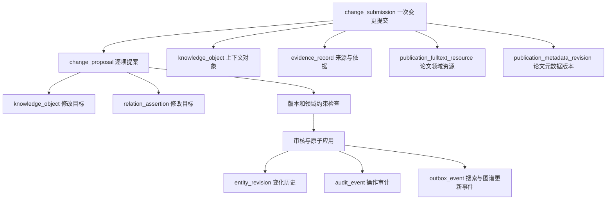

# 通用变更管理（V41）

2026-09-07，已应用到当前本地系统。工作台入口：`/knowledge-hub/changes`。

## 实际结构

箭头表示业务关联。精确外键：提案持有submission_id；上下文由提交的context_object_id指定；目标由提案的target_object_id或target_relation_id指定；全文和论文版本持有submission_id。文件与书目版本仍为论文领域数据。

### change_submission

由原publication_supplement物理重命名而来，原UUID和全部273行内容保留。

- submission_id：统一提交ID。
- context_object_id：本次提交的业务上下文，不要求与每个提案目标相同。
- workflow_key：publication使用论文适配器；entity使用通用对象/关系修改器。
- evidence_id、source_kind、source_label、source_uri、payload：来源和提交原貌。
- status、impact、decided_by、decided_at、decision_reason：整体处理情况。
- base_version、applied_version：上下文版本信息；论文流程使用元数据版本，通用多目标的并发控制以逐项提案基础版本为准。

### change_proposal

由原publication_change_candidate物理重命名而来，原UUID和全部213行内容保留。

- proposal_id、submission_id：提案身份及归属。
- target_object_id / target_relation_id：两个真实外键，必须且只能填一个。
- base_version：目标的基础版本。
- field_path、current_value、proposed_value、change_type、risk_level：要修改什么及修改依据。
- status：待审核、自动处理、接受或拒绝。
- application_state：pending、applied、not_applicable、conflict，单独表达是否实际应用。
- applied_at：应用时间；历史已应用提案使用原记录的决定/更新时间回填，不声称这是重新观测的精确历史执行时间。

一个提交可覆盖多个对象与关系；同一提交中同一目标字段不能重复。当前通用审核整批接受或拒绝，论文审核保留逐项选择。通用流程锁定全部目标、校验全部基础版本，然后按目标合并写入；同一目标只推进一次版本。出现版本冲突时不应用任何目标，保留冲突状态，用户可拒绝后重新提交。重复审核已完成提交不会重复应用。

## 领域边界和当前能力

- 通用工作台支持查找人物、机构、部门、项目、资助计划、学科、概念，提交规范名称或说明修正；页面明确显示前100条搜索结果与最近100次通用提交。
- 通用API还支持注册过的属性键和关系置信度/注册属性修改，仍受现有类型、属性、关系、身份和证据约束约束。对象子类型record_kind不允许通过此通道调整。
- 论文和期刊对象不允许通过通用修改器直接修改，以免绕过其权威元数据/身份同步规则。
- 论文补充使用同一提交和提案表，继续负责全文、标识、元数据、资助关系等领域操作；增加了元数据版本冲突检查。
- 本轮没有实现所有领域的新建、合并、退役、机构层级调整或任意字段修改适配器，也没有提供绕过领域规则的任意SQL入口。
- 通用提交当前必须人工审核；低风险自动应用继续由论文领域已有规则负责。
- application_state与审核状态分列保存，但当前执行是审核请求内同步原子应用，并未额外构建异步审批执行器。

## 现有论文流程迁移

- publication_supplement → change_submission。
- publication_change_candidate → change_proposal。
- supplement_id → submission_id；candidate_id/candidate_ids → proposal_id/proposal_ids。
- base_metadata_version → base_version；target_metadata_version → applied_version。
- publication_fulltext_resource、publication_metadata_revision外键字段统一为submission_id。
- API契约、生成客户端、页面、活动脚本同步更新，没有旧物理表、兼容视图或旧字段别名。
- 论文补充的领域函数、页面和权限名称仍描述真实论文业务，不属于旧结构兼容入口。历史迁移和审计原文保留。

## 权限与历史

新增change.submit和change.decide权限，按现有论文提交/审核角色分配。通用提交只供提交人或有审核权限者读取，并继续受目标对象/关系本身的数据库行级权限约束。历史由entity_revision记录，应用角色没有因此获得历史表的额外读取权限。

新API：POST/GET `/api/v1/changes`，GET `/api/v1/changes/{submission_id}`，POST `/api/v1/changes/{submission_id}/decision`。论文专属提交与审核仍走论文领域API。

## 验证与保全

- 隔离恢复数据库完成迁移演练；旧数据库约束和模型测试通过。
- 实际业务测试覆盖多对象/关系提交、审核前不变、应用、重复审核、冲突、拒绝、证据连接、非相关操作者读取隔离及论文领域历史与应用。
- HTTP测试覆盖提交、读取、审核及非法属性拒绝。
- 后端137项测试、前端38项测试、类型检查、Lint、API契约一致性和构建通过。
- 浏览器两项回归通过：新工作台交互使用网络拦截避免生产写入；论文核验读取使用真实接口。
- 生产上线后概览、论文接入、通用变更、图谱分析均HTTP 200。
- 按字段重命名还原口径比较：273次提交、213项提案、270份全文、83个论文元数据历史、3102个对象物理行、6841条关系的原有内容指纹完全一致。
- 213项提案迁移后：183项自动已应用、6项人工接受已应用、24项仍待审核。本轮没有代替用户审核这些待处理数据。

审计文件位于`outputs/generic_changes_20260907`，含迁移前备份、前后指纹、迁移日志及测试日志。当前物理表总数仍为58，两个表改为通用名称。
