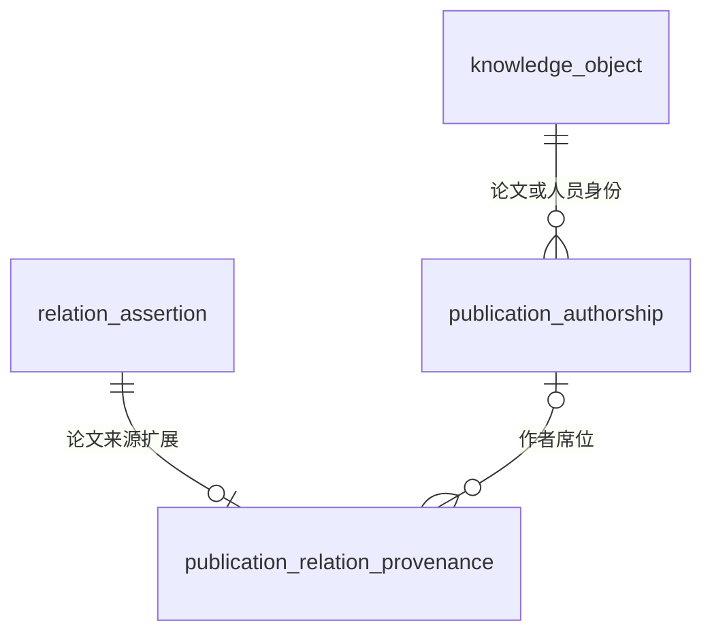
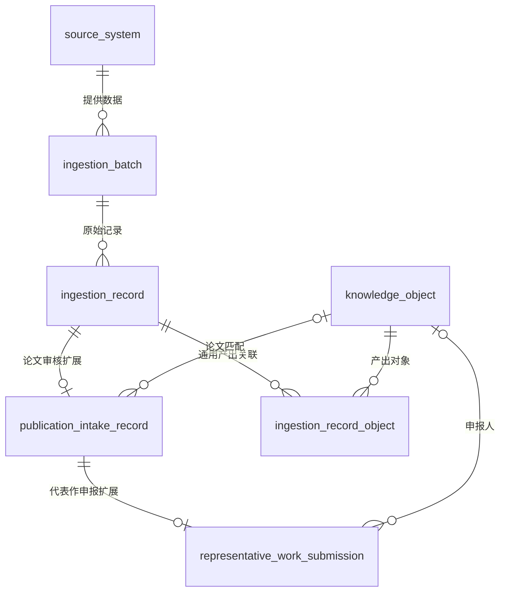

# 通用导入与领域来源扩展（V37–V40）

2026-09-07 已应用到当前本地运行系统；本文件描述实际结构。

## 1. 关系主表与论文来源分离

`relation_assertion` 已删除 `source_publication_authorship_id` 列。通用关系保留
`subject_id`、`predicate`、`object_id`、`context_object_id`、审核状态、版本和通用属性。

`publication_relation_provenance` 的字段：

| 字段 | 作用与约束 |
|---|---|
| `relation_id` | 主键，同时为关系主表外键；一条关系至多一个规范作者席位来源 |
| `publication_authorship_id` | 作者席位的真实外键；删除席位时置空，历史修改留在修订记录 |
| `created_at` | 来源扩展建立时间 |

论文中同一人的全部署名与角色仍由 `publication_authorship` 管理。`person.authored`
使用排序最前的有效席位作为规范来源；作者顺序、身份、状态改变时自动同步。已批准的
作者—机构关系必须有有效席位及同篇论文的已确认 PDF 证据；不能直接删除其来源后继续保留批准状态。

来源与关系在同一事务内写入，提交时执行可延迟约束。这样既能先建立关系再建立扩展，
也不会允许缺失或错配的来源提交入库。修订历史和已有证据关联均保留。

通用关系入口不再接受旧字段，传入会返回 422。论文专属创建入口为
`POST /api/v1/publications/relations`，其领域参数为 `publication_authorship_id`。
未来其他领域可建立自己的扩展表，无须向关系主表追加专属列。

图投影的新读写代码与实际 HugeGraph schema 均已移除旧作者来源属性。
已重建关系边结构，并逐条验证全部 6,841 条关系的内容与权威库一致。

## 2. 导入拆为通用层与业务扩展

| 实际表 | 主要字段 | 负责什么 |
|---|---|---|
| `ingestion_batch` | `batch_id`、`source_system_id`、`dataset_version`、`source_kind`、`pipeline_key`、`source_uri`、`source_checksum`、`source_locator`、批次状态、记录数、创建者与时间 | 一次导入及其来源；支持 file、api、manual、connector、stream |
| `ingestion_record` | `record_id`、`batch_id`、`source_record_key`、`record_kind`、`source_locator`、`raw_payload`、`normalized_payload`、`payload_checksum`、`processing_state` | 一条源记录；不强制具备表名、Excel 行号、论文 ID 或获奖人 |
| `publication_intake_record` | `record_id`、`verification_state`、`matched_publication_id`、`duplicate_of_record_id` | 论文核验状态、论文匹配与重复项处理 |
| `representative_work_submission` | `record_id`、`representative_work_number`、`awardee_name_raw`、`awardee_person_id` | 代表作编号与申报人信息；不代表论文作者身份 |
| `ingestion_record_object` | `record_id`、`object_id`、`output_role`、`created_at` | 供通用领域适配器记录一个输入产生的多个对象 |

旧数据的论文匹配继续以 `publication_intake_record.matched_publication_id` 为准；没有将它重复复制到
`ingestion_record_object`。后者用于后续通用适配器的对象产出，不是另一份论文匹配权威表。

`source_locator` 是可变来源定位信息，例如 Excel 的 `sheet/row`、接口的 `external_id`。
`source_record_key` 在批次内唯一；`dataset_version` 延续原有全局唯一约束，调用者应使用带来源命名空间的批次标识。
文件地址和校验和可以为空，因此接口或手工输入不需要虚构文件。原始载荷可以保留任意来源字段；
把国自然字段从公共表列中移出，并不删除原始 JSON 中作为历史证据保存的同名内容。

通用处理状态是 received/processing/processed/failed/cancelled。论文的人工审核状态单独保存，
导入成功不会自动批准论文、作者、机构或关系。

## 3. 当前系统直接使用原生结构

V39 已删除两个旧导入视图、配套写入触发器和 `write_publication_import_*` 函数。
系统没有用于旧导入入口的替代视图、重定向或双协议入口。

后端查询明确连接 `publication_intake_record`、`ingestion_record` 和必要的代表作扩展。
写入按事务分别操作实际表；审核锁定真实记录；领域状态变化由更新时间触发器通知原始记录。
这类更新时间触发器承担当前业务职责，不翻译旧结构。

数据库、后端模型、前端客户端和批处理脚本统一使用 `batch_id`、`record_id`。
字段核验、审核决定、核验层、全文预核验的外键列已改名为 `record_id`，UUID 值保持不变。
原始 JSON 和不可变审核历史继续保存其原始内容与字段名，不承担兼容新请求的职责。

当前论文接口为：

- `POST /api/v1/ingestion/publications`：单篇论文输入。
- `POST /api/v1/ingestion/publications/file`：CSV/XLSX 输入。
- `GET /api/v1/publications/intake`：论文核验列表。
- `GET /api/v1/publications/intake/{record_id}`：核验详情。
- `POST /api/v1/publications/intake/{record_id}/confirm` 或 `/reject`：审核决定。

原 `/api/v1/knowledge-hub/publication-imports`、其 `/batch` 路径和
`/api/v1/knowledge-hub/publication-verifications` 路径族已经移除，返回 404。
论文提交权限统一为 `publication_intake.submit`。前端与后端已同步部署；API 版本为 `1.0.0-alpha.20`。

## 4. 已可用的通用入口与扩展边界

- `POST /api/v1/ingestion/batches`：接收任意领域的结构化源记录。
- `GET /api/v1/ingestion/batches/{batch_id}`：查询该批次、原始内容与来源定位。
- 权限：`ingestion.submit`，已赋予 `knowledge_admin`；数据依旧受创建者行级隔离。
- 完全相同的重复提交复用批次；同一批次标识对应不同请求返回 409。
- 新输入先保存原始记录，不自动创建业务对象。

示例请求的 `record_kind` 可以是 `dataset`，无需提供获奖人、代表作号或 Excel 行号。
新的专利、项目、设备等领域，可以复用接收层，再接入各自的标准化、审核、匹配与正式入库适配器。
此次已提供通用接收结构和接口；具体外部连接器及所有新领域的解析审核流程不因结构通用化而自动生成。
既有论文工作台的单篇和 CSV/XLSX 入口继续可用。

## 5. 迁移和验证记录

已通过 Flyway 正式应用 V37、V38、V39。先做完整备份，再在独立恢复的测试库重演；
另以非空作者席位夹具验证来源迁移，避免只验证生产库当前作者数为零的情况。

当前关键数据：269 篇有效论文、283 条代表作申报、270 份全文资源、286 条审核决定、0 条作者署名。
通用批次、源记录、论文和代表作扩展，以及全部对象、关系、审核决定、全文资源，迁移前后内容摘要一致；
记录 ID、载荷及原有时间戳均保留。未批准任何待审核作者机构结果。

本轮验证包括：137 项后端测试、38 项前端测试、69 条相关 SQL 校验、数据库综合校验、
原生单篇/CSV 输入及审核驳回、旧接口 404、新 ID 契约、浏览器中核验列表和证据详情、
图接口及全部关系内容核对。前端类型检查、构建和相关 Python 静态检查通过。

V37–V38 记录保存在 `outputs/model_refactor_20260906/`；V39 清理、备份与验证记录保存在
`outputs/remove_compatibility_20260906/`。历史迁移文件保留以便从空库重放和核对 Flyway 校验和，
已经移除的旧设施不会因此出现在当前运行库。

## V40：取消关系名称别名层

V40取消了relation_predicate_alias和两个废弃定义。V70进一步停用独立致谢关系。
论文受具体项目支持统一使用publication.supported_by_project，致谢仅保留为来源证据；未定位项目时保留待匹配线索，不创建独立关系。机构隶属使用organization.part_of。旧名称在数据库写入时被拒绝。

论文补充流程仅在可定位项目时创建项目资助关系，不再根据资助方名称创建机构关系；补充对象使用
supplement_funding子类型及明确属性契约。现有项目、论文及关系数据未迁移改写，
因为V40应用前两个旧名称在关系表中均为0条。固定历史批次的资助导入/清理脚本
已从活动scripts目录移至outputs/remove_predicate_alias_20260907归档，不能作为当前入口运行。

## V41：补充流程升级为通用变更管理

当前详情见[通用变更管理](generic-change-workflow.md)。原publication_supplement和publication_change_candidate已物理改为change_submission、change_proposal，相关ID和API字段同步更新，不保留兼容视图。
