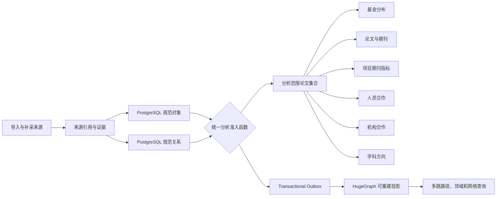

# 学者星图分析数据流与统一准入规则

## 1. 数据模型

PostgreSQL 是唯一权威事实源。分析涉及的核心数据分为四层：

| 层次 | 主要表 | 作用 | 状态字段 |
|---|---|---|---|
| 规范对象 | `knowledge_object` | 论文、学者、机构、项目、项目种类、期刊、学科等稳定对象 | `review_state`、`quality_state`、双时间、`version` |
| 规范关系 | `relation_assertion` | 作者、署名机构、项目资助、期刊、学科等关系 | `review_state`、置信度、双时间、`version` |
| 来源与证据 | `source_reference`、`evidence_record`、`relation_evidence`、领域来源扩展表 | 保存原始出处、全文位置、核验依据和可追溯性 | 证据核验状态、可见性 |
| 领域读模型 | `publication_metadata`、期刊指标发布及匹配表等 | 保存论文元数据和版本化指标结果 | 论文核验流程状态、指标发布状态、匹配状态 |

`review_state` 表示对象或关系是否经过治理审核；`quality_state` 表示数据质量提示；论文核验流程状态表示论文记录的业务核验阶段。三者不能互相替代。

## 2. 当前统一准入规则

数据库函数 `smartlib.analysis_state_eligible(review_state)` 是分析和图投影共同使用的唯一状态准入规则。

| `review_state` | PostgreSQL 分析 | PostgreSQL 图查询基线 | HugeGraph 投影与图查询 |
|---|---:|---:|---:|
| `pending` | 纳入 | 纳入 | 纳入 |
| `approved` | 纳入 | 纳入 | 纳入 |
| `rejected` | 排除 | 排除 | 删除或不投影 |
| `superseded` | 排除 | 排除 | 删除或不投影 |

当前规则只按 `review_state` 控制准入，不使用 `quality_state`、证据状态或历史 `analysis_enabled` 属性拦截待核数据。待核状态仍随结果返回，用于提示可信程度。

对象、关系和关系两端的对象都必须满足统一规则，并且必须是当前系统版本（`system_to = infinity`）。

## 3. 分析数据流

分析范围先由时间、项目种类、机构、学者条件圈定出唯一的论文 ID 集合。六个页面模块均以该集合为分母或输入，不再各自重新圈定论文范围。

## 4. 六个模块的关系语义

| 模块 | 主要关系或记录 | 统计对象 | 状态处理 |
|---|---|---|---|
| 基金分布 | `publication.supported_by_project` | 具体项目、项目种类、论文数、关系数 | 待核和已核均参与，状态分开展示 |
| 论文与期刊 | `publication.published_in` | 期刊与不同论文数 | 关系和期刊对象均走统一准入规则 |
| 项目期刊指标 | `project.has_representative_publication`、`publication.supported_by_project` | 项目、不同论文、项目论文关系、同年期刊指标 | 项目关系均走统一准入；指标仍须是已发布、匹配成功且年份与论文发表年一致 |
| 人员合作 | `person.authored` | 两位作者共同署名的不同论文数 | 作者关系和人员对象均走统一准入 |
| 机构合作 | 论文语境内的 `person.affiliated_with` | 两个机构共同出现在同一论文署名中的不同论文数 | 署名机构关系和机构对象均走统一准入 |
| 学科方向 | `publication.classified_as_discipline` | 各分类体系主分类论文数；辅分类单列 | 待核和已核均参与，状态保留 |

期刊指标的 `release_state`、`match_state` 是指标产品本身的发布和匹配约束，不是论文或关系的核验限制，因此仍独立执行。

## 5. PostgreSQL 与 HugeGraph 的职责

- PostgreSQL 负责权威对象、关系、证据、范围筛选和当前页面的聚合统计。
- HugeGraph 负责由同一准入规则生成的可重建图投影，以及多跳路径、邻域、合作网络扩展和后续图算法。
- OpenSearch 只负责检索召回，不参与这些统计口径。
- 前端只调用 API，不直接连接三种存储。

页面显示“图谱分析”是产品功能名称，不表示六个聚合模块全部在 HugeGraph 内计算。当前聚合从 PostgreSQL 权威事实层计算，关系路径和网络查询由 HugeGraph 提供；两者使用同一个准入函数保证参与范围一致。

## 6. 自定义图查询范围

自定义范围使用 HugeGraph 的只读 Cypher 接口圈定论文，再将返回的论文 ID 与 PostgreSQL
中 `smartlib.analysis_state_eligible` 的可见当前论文取交集。交集结果作为第七种范围条件，与年份、
项目种类、机构和学者条件共同约束六个分析模块。

查询接口只接受单个固定路径 `MATCH`，不允许写操作、过程调用、可变长度路径、子查询或自行设置
`LIMIT`。所有节点必须使用 `knowledge_object` 标签，所有关系必须使用 `relates` 标签，并以
`RETURN DISTINCT publication.object_id AS publication_id` 结束。后台自动注入访问范围、5秒超时和
5,000篇结果上限。

保存的是查询定义，不是一次执行得到的论文 ID 清单。每次选择已保存范围都会重新查询 HugeGraph，
随后重新应用 PostgreSQL 的可见性与状态准入规则，因而可以反映最新图数据且不绕过未来状态收紧。

## 7. 未来收紧状态的操作规则

未来如果决定待核数据不再参与分析，应按一个变更完成：

1. 修改 `smartlib.analysis_state_eligible`，例如仅允许 `approved`；
2. PostgreSQL 六个分析模块自动按新规则过滤；
3. PostgreSQL 图查询基线自动按新规则过滤；
4. 为全部当前对象和关系重新发送 Outbox 事件；
5. HugeGraph 对不满足规则的节点和边执行删除，对满足规则的记录重新投影；
6. 等待投影队列清零后，执行 PostgreSQL/HugeGraph 对账，再发布页面。

不得先单独修改页面 SQL，也不得只清理 HugeGraph。任何准入变更都必须同时完成规则变更、全量投影重放和双存储对账。

## 8. 对账验收

每次状态策略或投影逻辑变化后至少检查：

- 准入函数对四种状态的真值是否符合决策；
- 当前对象、当前关系及关系两端对象是否都满足规则；
- PostgreSQL 与 HugeGraph 的节点、边总数和按状态、谓词分组数量；
- 关系 ID 集合、`review_state` 和版本是否一致；
- 投影队列是否清零；
- 同一筛选条件下六个模块返回的 `scope.publication_count` 是否相同；
- 各模块覆盖率差异是否来自缺失关系，而不是状态条件不同。

合作网络默认只显示达到共同论文阈值的边，截断只影响展示，不改变底层参与范围和覆盖统计。
